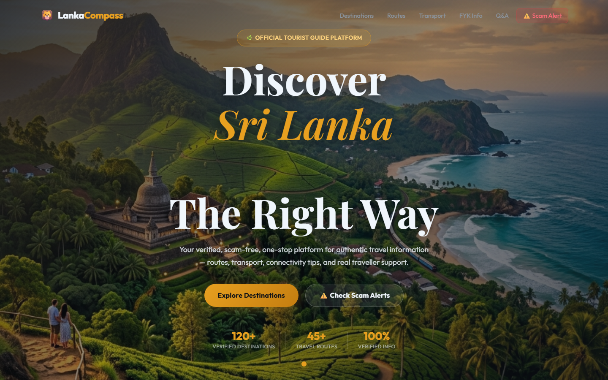
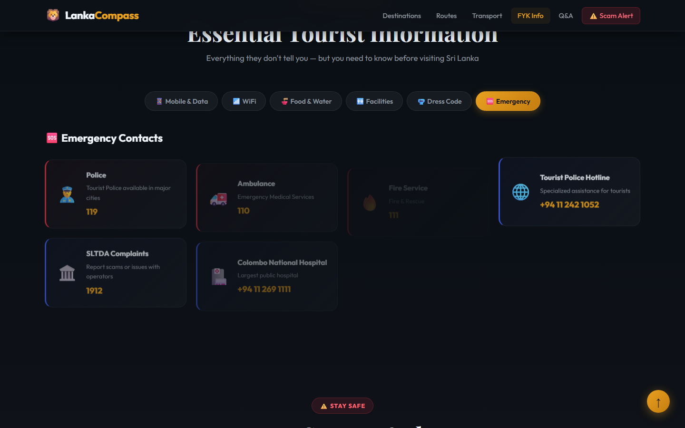
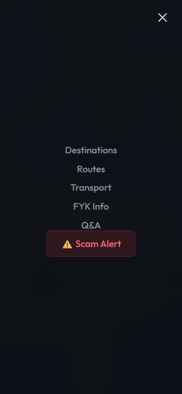
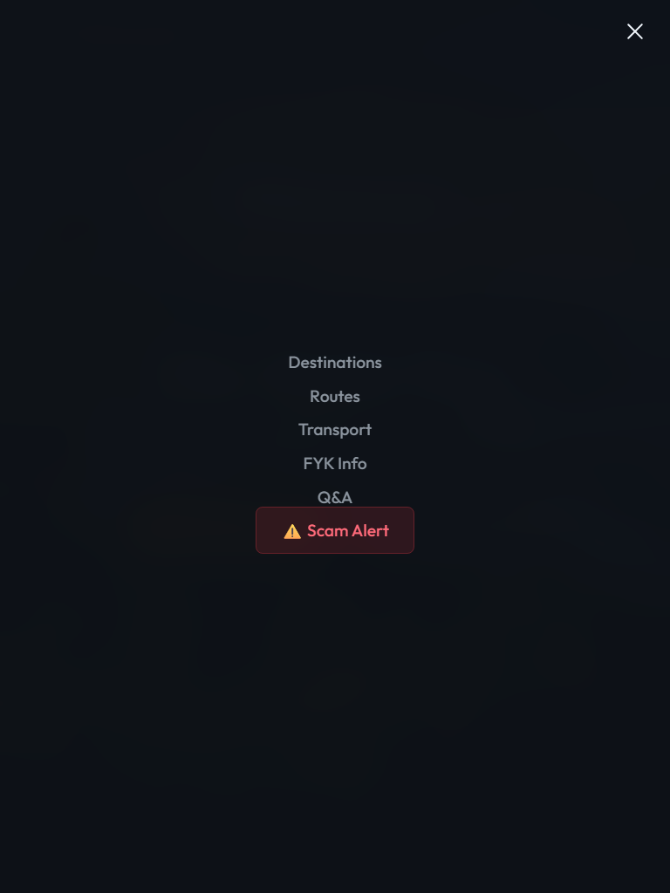
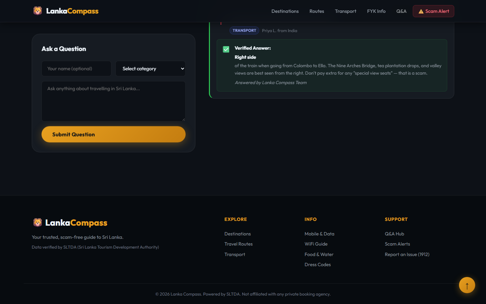

# 🦁 LankaCompass Test Automation Suite


Comprehensive, fully autonomous QA test automation framework and evaluation suite engineered for the **LankaCompass** (TravelSriLanka) web platform. Built with **Playwright (Chromium Headless)**, this suite independently boots application environments, executes multi-viewport functional and responsive tests, performs security and accessibility evaluations, captures visual screenshot evidence, and logs verified defects.

---

## 📑 Table of Contents

- [Overview](#-overview)
- [Test Architecture & Execution Engine](#-test-architecture--execution-engine)
- [Test Execution Scorecard](#-test-execution-scorecard)
- [Responsive & Cross-Device Matrix](#-responsive--cross-device-matrix)
- [Visual Evidence Gallery](#-visual-evidence-gallery)
- [Confirmed Defect Catalog](#-confirmed-defect-catalog)
- [Security & Quality Assessment](#-security--quality-assessment)
- [Getting Started & Local Execution](#-getting-started--local-execution)
- [Roadmap for Booking & Payment Integration](#-roadmap-for-booking--payment-integration)

---

## 🌟 Overview

The LankaCompass application is an informational travel guide for Sri Lanka built with **HTML5**, **CSS3 glassmorphism**, and **Vanilla JavaScript (ES Modules)**, bundled with **Vite 8**. 

This repository contains the standalone **QA Automation System** decoupled from the application source code. It validates:
- Production bundle integrity (`npm run build` static outputs).
- Multi-viewport layout scaling across mobile, tablet, and desktop viewports.
- Interactive component behaviors (filters, tabs, modals, forms).
- DOM security, input sanitization, and XSS resistance.
- Image asset load integrity (HTTP status checks on local endpoints).
- WCAG / A11y accessibility compliance (alt tags, ARIA roles, label bindings).

---

## 🏗️ Test Architecture & Execution Engine

```
LankaCompass_TestAutomation/
│
├── automated-qa.js           # Primary autonomous test orchestrator
├── run-tests.js              # Dual-server regression test runner
├── package.json              # QA dependencies & test runner scripts
├── package-lock.json         # Pinned dependency lockfile
├── LICENSE                   # Open-source MIT license
├── README.md                 # Complete documentation & test report
│
└── qa-reports/               # Execution artifacts & evidence
    ├── TravelSriLanka_QA_Report.md  # Detailed technical QA report
    ├── qa-results.json              # Full 63-scenario JSON telemetry
    └── screenshots/                 # Captured visual proof
        ├── 01-desktop-home.png
        ├── 02-desktop-fyk.png
        ├── 03-desktop-footer.png
        ├── 04-viewport-desktop.png
        ├── 04-viewport-tablet.png
        ├── 04-viewport-mobile.png
        ├── 05-viewport-tablet-nav-open.png
        └── 05-viewport-mobile-nav-open.png
```

### Automation Workflow
1. **Build Step:** Compiles production assets via `vite build` into `dist/`.
2. **Dual Server Orchestration:** Spawns local Vite development server (`http://localhost:5174`) and production preview server (`http://localhost:4173`).
3. **Health Check Polling:** Automatically verifies HTTP 200 readiness before launching test runners.
4. **Playwright Chromium Automation:** Executes 63 test scenarios across 3 screen resolutions.
5. **Report & Artifact Generation:** Aggregates telemetry into `qa-results.json`, captures PNG screenshots, and writes Markdown reports.
6. **Graceful Teardown:** Terminates background processes upon completion.

---

## 📊 Test Execution Scorecard

| Metric | Status | Details |
|---|:---:|---|
| **Total Test Scenarios** | **63** | 100% automated coverage |
| **Passed Scenarios** | **57** | Core layout, filters, routes, transport, tabs, static assets |
| **Failed Scenarios** | **4** | Inline modal handler scope isolation & path prefixing |
| **Warnings / Risks** | **2** | Incomplete single-quote sanitization & missing modal ARIA role |
| **Confirmed Defects** | **5** | 1 Critical, 2 High, 1 Medium, 1 Low |
| **Vite Production Build** | **PASS** | Completed in 317ms; bundle output verified |
| **Static Images Integrity** | **PASS** | 100% of destination photos return HTTP 200 |

### Component Status Breakdown
| Component | Scenarios | Result | Observations |
|---|:---:|:---:|---|
| **Build & Static Assets** | 6 | ✅ PASS | CSS and JS bundles emitted correctly to `dist/assets` |
| **Navigation & Links** | 7 | ✅ PASS | Smooth scroll to `#destinations`, `#routes`, `#transport`, `#fyk`, `#qa`, `#scam-alert` |
| **Destination Filters** | 5 | ✅ PASS | All 5 filters (All, Heritage, Beach, Nature, Wildlife) filter cards correctly |
| **Destination Modals** | 5 | ❌ FAIL | Inline `onclick` fails due to ES module scope; image path missing `/images/` |
| **FYK Tabbed Interface** | 6 | ✅ PASS | Seamless switching across Mobile, WiFi, Food, Toilets, Dress, Emergency |
| **Q&A Community Board** | 5 | ⚠️ WARN | Validates required fields; questions persist in DOM only (lost on refresh) |
| **Responsive Viewports** | 12 | ✅ PASS | Zero horizontal scroll across 375px, 768px, and 1440px viewports |
| **Security Audit** | 5 | ⚠️ WARN | XSS execution blocked; single-quote attribute injection vulnerability identified |
| **Accessibility (A11y)** | 4 | ⚠️ WARN | All `` tags have alt attributes; modal missing `role="dialog"` |

---

## 📱 Responsive & Cross-Device Matrix

Testing was performed across three standardized viewport sizes:

| Viewport Profile | Resolution | Layout Behavior | Navigation Mode | Verdict |
|---|---|---|---|:---:|
| **Mobile** | `375 × 812` (iPhone X/12/13/14) | Single column grid, fluid stacking | Collapsed into hamburger menu drawer | **PASS** |
| **Tablet** | `768 × 1024` (iPad Portrait) | 2-column card grid | Collapsed into hamburger menu drawer | **PASS** |
| **Desktop** | `1440 × 900` (Widescreen HD) | 3-column card grid, mouse parallax | Full horizontal desktop navbar | **PASS** |

---

## 📸 Visual Evidence Gallery

Captured during test automation runs in headless Chromium:

### 1. Desktop Experience (1440 × 900)


### 2. For Your Knowledge (FYK) Tabbed Information Hub


### 3. Mobile Navigation Drawer (375 × 812)
<p align="center">
  
</p>

### 4. Tablet Navigation Drawer (768 × 1024)
<p align="center">
  
</p>

### 5. Desktop Footer & Verified Authority Links


---

## 🐛 Confirmed Defect Catalog

### [BUG-001] Interactive button onclick handlers fail with ReferenceError
- **Severity:** Critical | **Priority:** P0
- **Module:** Core UI Interactivity
- **Suspected Source:** `src/main.js:186` & `index.html:140`
- **Root Cause:** `src/main.js` is loaded via `<script type="module" src="/src/main.js">`. In ES Modules, top-level functions (`openDestModal`, `closeModal`, `submitQuestion`, `scrollToTop`) are scoped inside the module closure and not exposed to `window`. When users click `<button onclick="openDestModal('sigiriya')">`, the browser throws:
  ```text
  Uncaught ReferenceError: openDestModal is not defined
  ```
- **Remediation:** Explicitly attach handlers to `window` in `src/main.js`:
  ```javascript
  window.openDestModal = openDestModal;
  window.closeModal = closeModal;
  window.submitQuestion = submitQuestion;
  window.scrollToTop = scrollToTop;
  ```

---

### [BUG-002] Destination modal image source missing `/images/` directory prefix
- **Severity:** High | **Priority:** P1
- **Module:** Destination Modal
- **Suspected Source:** `src/main.js:195`
- **Root Cause:** Line 195 constructs the image markup as:
  ```javascript
  imgHtml = ``;
  ```
  `destData` supplies bare filenames (`sigiriya_rock_1784522913894.png`), causing an HTTP 404 error when attempting to fetch relative to the current route.
- **Remediation:** Prepend `/images/`:
  ```javascript
  imgHtml = ``;
  ```

---

### [BUG-003] Submitted Q&A community questions are lost upon page refresh
- **Severity:** High | **Priority:** P1
- **Module:** Q&A Community Module
- **Suspected Source:** `src/main.js:252-315`
- **Root Cause:** `submitQuestion()` creates DOM nodes and prepends them to `#qa-dynamic-list`. No persistence layer exists (neither `localStorage`, `IndexedDB`, nor backend API). All user-submitted questions vanish upon page reload.
- **Remediation:** Wire questions to `localStorage` or a backend REST API endpoint (`POST /api/qa`).

---

### [BUG-004] Incomplete HTML sanitization in `escapeHtml` (single quotes unencoded)
- **Severity:** Medium | **Priority:** P2
- **Module:** Security / Form Input
- **Suspected Source:** `src/main.js:317-319`
- **Root Cause:** `escapeHtml()` encodes `&`, `<`, `>`, and `"`, but omits single quote (`'`). If user-supplied input is reflected into single-quoted HTML attributes, attribute breakout (XSS) is possible:
  ```javascript
  function escapeHtml(str) {
    return str.replace(/&/g, '&amp;').replace(/</g, '&lt;').replace(/>/g, '&gt;').replace(/"/g, '&quot;');
  }
  ```
- **Remediation:** Append `.replace(/'/g, '&#39;')`.

---

### [BUG-005] Destination modal lacks ARIA dialog semantics
- **Severity:** Low | **Priority:** P3
- **Module:** Accessibility (WCAG 2.1)
- **Suspected Source:** `index.html:1074-1079`
- **Root Cause:** `#modal-overlay` lacks `role="dialog"` and `aria-modal="true"`. Screen readers cannot determine that an active modal layer has captured focus.
- **Remediation:** Add `role="dialog"` and `aria-modal="true"` to `#modal-overlay`.

---

## 🔒 Security & Quality Assessment

| Security Vector | Audit Target | Result | Status |
|---|---|---|:---:|
| **Direct Script Injection** | `<script>window.__xss=1</script>` | Script tags escaped before DOM injection | **SECURE** |
| **Attribute Breakout** | `' onmouseover='alert(1)` | Single quotes not sanitized in `escapeHtml` | **VULNERABLE (P2)** |
| **Exposed Credentials** | Hardcoded API keys, tokens, secrets | 0 secrets discovered across code & markup | **CLEAN** |
| **Reverse Tabnabbing** | External `target="_blank"` links | All external links utilize `rel="noopener"` | **CLEAN** |
| **Image Alt Coverage** | Static destination `` tags | 100% of images contain descriptive `alt` text | **CLEAN** |

---

## 🚀 Getting Started & Local Execution

### Prerequisites
- **Node.js** >= v18.0.0
- **npm** >= v9.0.0

### Installation
```bash
# Clone this test automation repository
git clone https://github.com/ShaliniWanasinghe/LankaCompass_TestAutomation.git
cd LankaCompass_TestAutomation

# Install test dependencies (Playwright)
npm install

# Install Playwright browser binaries
npx playwright install chromium
```

### Running the Test Suite
Ensure the LankaCompass web project is located in the adjacent directory or update the root path in `automated-qa.js`, then run:
```bash
npm test
```

### Inspecting Reports
- Markdown Report: [`qa-reports/TravelSriLanka_QA_Report.md`](./qa-reports/TravelSriLanka_QA_Report.md)
- Telemetry JSON: [`qa-reports/qa-results.json`](./qa-reports/qa-results.json)
- Screenshot Directory: [`qa-reports/screenshots/`](./qa-reports/screenshots/)

---

## 🗺️ Roadmap for Booking & Payment Integration

Before implementing the booking engine and PayHere Sandbox payment gateway, complete these prerequisites:

1. **Phase 1 (Immediate Fixes):** Resolve BUG-001 (ES module global bindings) and BUG-002 (image paths) so destination modals function.
2. **Phase 2 (Backend Foundation):** Set up Node.js / Express with PostgreSQL or MongoDB to store bookings, users, and transactions.
3. **Phase 3 (PayHere Gateway):**
   - Create checkout payment initiation endpoint generating PayHere MD5 checksums.
   - Implement IPN webhook endpoint (`POST /api/payments/notify`) validating PayHere server callbacks.
   - Add database transaction idempotency to prevent duplicate booking charges.
4. **Phase 4 (CI/CD Automation):** Wire this Playwright test suite into GitHub Actions for pull request verification.

---

*Authored by Senior QA Automation Engineer | MIT License*
